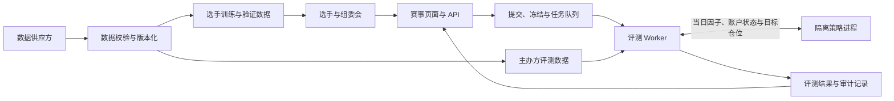

# AgentQuant Competition

第 31 届智能体大赛赛道 2 · 系统技术方案

## 本地开发

参赛工作台提供内置策略提交、历史记录、验证任务与结果查询。后端使用人工行情演练从注册组队到正式评测和发榜的流程。API 与 Worker 默认共用 `.agentquant/local.sqlite3`，可用 `AGENTQUANT_DB` 指定同一个数据库文件。

准备 uv 和 Node.js 22.12 或更新版本。仓库设置默认 Python 3.12。在仓库根目录安装后端依赖。

```powershell
uv sync --locked
```

打开两个终端，在仓库根目录分别启动 API 和 Worker。

```powershell
uv run --locked uvicorn agentquant.api:app --reload
```

```powershell
uv run --locked python -m agentquant.worker
```

第三个终端启动前端，打开终端给出的地址（默认 `http://localhost:5173`）。填写提交名称并保存，然后从提交历史发起验证。结果页可刷新，最近任务可从发起验证的浏览器重新打开。API 调试页在 `http://127.0.0.1:8000/docs`。

```powershell
Set-Location apps/web
npm ci
npm run dev
```

默认可匿名验证内置策略。匿名提交保存在独立的演示范围。使用右上角「登录」进入参赛队伍工作台。

在仓库根目录运行 `npm --prefix apps/web run build` 生成生产构建。托管时将 `/api/` 转发到 FastAPI，并将其他前端路由交给 `index.html`，以支持直接打开验证结果页。

在仓库根目录可单独运行因子排序基线及测试。

```powershell
uv run --locked python -m agentquant.demo
uv run --locked pytest
```

### 登录和赛事联调

设置 `AGENTQUANT_ALLOW_DEMO=0` 启动 API，即可用认证模式联调。HTTPS 环境同时设置 `AGENTQUANT_SECURE_COOKIE=1`。在 API 所用的数据库上签发注册邀请码，角色可选 `participant`、`organizer` 或 `reviewer`。

```powershell
uv run --locked python -m agentquant.accounts participant
```

前端支持用注册邀请码创建账号。登录后，通过「我的队伍」创建队伍或用组队码加入，再保存内置策略、发起验证并查看本队结果。组队码只在建队后显示。

可通过 `/docs` 或 HTTP 客户端演练其他赛务流程。已登录的写请求需要传入登录响应中的 `csrf_token`，请求头为 `X-CSRF-Token`，Web 客户端会自动附带。启动时会迁移旧版 SQLite 文件中的提交和任务。完整请求顺序见[接口说明](contracts/README.md)。

策略 ZIP 支持结构校验、下载和版本留存。正式开放选手策略运行需要接入评测侧沙箱。真实行情由独立数据工作包交付，正式部署和验收安排见[开发计划](赛道2开发计划.md#11-部署与上线验收)。

## 1. 赛题与参赛流程

选手组织 Agent 在指定 A 股股票池中研究策略。平台提供匿名数值因子，选手用 10 年训练数据做研究，在随后 1 年的验证区间反复评测和改进。封榜前，每队指定一份最终策略。平台用封榜后一个月的真实 A 股行情统一运行已冻结的策略，在模拟资金账户上核算扣除交易成本后的收益，结合报告与创新性评分发布总成绩。[大赛设计第 2 节](第31届智能体大赛设计.md#2-track-2智能体解决真实问题)

本方案采用日频、仅做多的现金账户。选手提交可执行的 Python 策略及其离线模型参数，每日按匿名因子输出目标仓位。平台统一处理交易与计分。日频、策略接口和下面的成交假设是本方案的工程设计，赛前通过规则、SDK 和可手算样例一并发布。资金规模、费率、仓位约束和评分权重等数值由组委会确认后版本化。

| 阶段 | 选手做什么 | 平台提供什么 |
| --- | --- | --- |
| 训练 | 使用 Agent 分析数据、提出假设、训练模型或编写规则 | 10 年训练数据、SDK、样例策略、可在公开样例上使用的离线评测工具和教学材料 |
| 验证 | 查看随后 1 年的因子数据，提交策略并根据反馈迭代 | 验证因子包、统一评测、净值与诊断反馈、提交记录和配额 |
| 封榜 | 在截止前从合格提交中指定最终策略，并按赛程提交报告 | 冻结每队最终版本并生成回执，记录缺少有效提交的队伍 |
| 正式测试与发榜 | 回顾研究过程，提交或补充组委会允许的报告材料 | 持续收集一个月的正式数据，收齐后统一评测，组织报告评审、复核和发榜 |

Agent 可用于赛前研究、编码、模型训练和验证反馈分析。正式运行入口执行已提交的策略，允许调用随策略提交的离线模型，运行环境禁止对外联网。报告附关键实验、选用的验证提交编号及可复现步骤，说明 Agent 如何参与、哪些反馈导致了策略改变。

## 2. 数据与可见时间

### 数据分区

| 分区 | 时间范围 | 选手可见内容 | 主办方评测输入 |
| --- | --- | --- | --- |
| 训练 | 按赛程公布的连续 10 年 | 匿名因子、稳定标的 ID、数据字典。若提供未来收益标签，在训练包发布并单独标记。 | 历史因子、行情、交易日历、可交易状态与公司行动 |
| 验证 | 训练期后的连续 1 年 | 匿名因子与验证任务反馈，验证成绩供迭代使用 | 同口径因子、行情及交易规则所需数据 |
| 正式 | 封榜后的一个月，赛前公布起止时间与纳入的交易日规则 | 评测中的程序仅逐日收到已到可见时点的输入。结果按赛事发布规则开放。 | 封榜后实际产生的同口径因子、行情及交易状态 |

- 公开数据以交易日和稳定标的 ID 为键，同一因子在三个阶段使用同一列 ID、单位和缺值约定。真实因子名和计算定义由主办方保存。SDK 公开数值类型、缺值语义、数据时点和允许的使用方式。
- 主办方保存因子的原始快照、可用时间和生成版本。以当时已知的信息构造历史特征和交易资格，保留退市、停牌和更正记录。若股票池按规则变动，赛前公布规则，评测只使用每个交易时点已生效的成员与资格。缺失因子按约定表示，禁止使用后续观测回填。
- 若数据覆盖与发布权限允许，建议提供一个基准训练标签，以决策日后的第一个交易日开盘为起点、第二个交易日开盘为终点，计算计入期间权益变化的单日持有收益。任一端缺少有效开盘价时标签留空。按标签的最晚观察时间，从训练尾部剔除观察窗口触及验证期的样本。标签与因子分开存放，策略运行输入只取因子白名单。标准化或填补等拟合参数使用训练数据，日常策略只能用截至当前时点已送达的数据更新。
- 正式期因子须能在约定决策时点交付。主办方每天登记各输入批次的原始到达时间，校验日期覆盖、股票池、重复数据、因子版本、交易状态和价格单位。迟到或修订按公布的截止与补数规则处理，并留下批次记录。

数据组先向 Einsia.ai 确认可提供的样本、历史覆盖、正式期更新承诺和授权范围。还须取得未复权的执行参考价、标的涨跌停价与交易状态、历史交易日历、公司行动。每次发布或评测均保存数据清单，记录来源、覆盖范围、模式版本、批次与校验值。第三方执行数据和许可范围由主办方保管，选手下载包单独生成。

## 3. 策略接口

以 Python SDK 提供本地和平台统一的入口。每个评测任务使用一个全新策略实例，按交易日顺序调用，实例可在任务内保留状态。选手可在本地训练并把模型参数随提交打包。验证和正式任务各自从相同初始资金的空仓账户开始。

| 契约 | 首版字段与行为 |
| --- | --- |
| 提交包 | 入口、SDK 版本、策略代码、所需模型文件。平台提供固定依赖环境和容量上限。 |
| 每日输入 | 决策交易日、决策时间、当时可见的因子表和可选标的 ID、账户现金、当前持仓及可卖数量。可选标的依据当时生效的股票池和买入资格生成。 |
| 每日输出 | `KEEP` 保持持仓，或 `TARGET` 加标的与整数基点权重。权重合计最高 10,000 基点。目标列表省略的持仓按目标零处理，剩余权重留为现金。空目标列表表示清仓意图。 |
| 验证规则 | 校验标的、重复项、仓位上限和可解析性。超时、进程崩溃和非法输出分类记录。挂起订单只对预定执行日有效。 |

交互使用类型明确、有大小上限的消息。选手实例由隔离进程运行，只有提交包、平台固定依赖和受限临时目录。主办方执行行情、数据凭据和其他队伍的内容均由评测器持有。SDK 基线包括保持现金、买入持有及简单因子排序，配公开样例和预期输出供本地核对。

## 4. 日频评测与模拟成交

### 每个交易日

1. **开盘前处理账户事项。** 根据生效日期办理已确认的公司行动和可卖数量结转。读取该日交易资格。碰到改变股数或参考价格的公司行动时，撤销该标的按前一日口径生成的调仓指令，并记录原因。
2. **模拟开盘成交。** 执行上一个决策日已生成的调仓指令，取当日未复权开盘价作参考。先卖后买，同方向按标的 ID 顺序处理。资金以实际可用现金为准。
3. **收盘后估值。** 以当日有效收盘价计算净值。停牌时按照公开规则使用最近有效标记价，并在权益变化时调整对应价格。记录成交、成本及未成交原因。
4. **送达因子并生成下一次调仓。** 在赛前规定的决策时点向策略发送截至该时点可见的因子及账户状态。用同一时点已知的净值和标记价，将目标权重换算为目标股数，按交易单位规则调整订单。下一交易日的价格由评测器在执行阶段使用。

每个评测窗口首日从现金开始，最早在第二个交易日成交。最后一个评测交易日完成成交和估值后直接结算，持仓按期末标记价计入净值。

### 成交模型与边界

- 首版使用开盘参考价和预设成本模拟一轮调仓。限制订单规模和持仓规模。滑点以赛前公布的规则计入，所有费率、舍入规则及生效日期纳入配置。只有日线时，成交模型依赖公开声明的简化假设；若增加开盘成交容量限制，使用可核验的开盘成交量或从决策时点已知的数据计算上限。
- 执行日停牌、方向受限或开盘参考价无效时，按规则跳过相应成交。调出股票池的标的禁止新增仓位，存量持仓仍可按该标的交易状态减仓。交易约束覆盖 T+1、买入单位、零股卖出、不同标的的涨跌停、资金不足和持仓不足。买入资金不足时，按稳定顺序缩到可买的合法数量，计入应付费用。剩余订单到期取消。已知停牌与供数异常分开处理，供数异常触发数据核验。
- 执行价使用未复权行情。分红、送转及退市等影响账户的事件通过权益或结算规则处理。数据组与评测组先核验样本中的各类事件，再发布支持的股票池与规则。资金和费用按固定精度记账。

例如，样例账户有 100,000 元，某股收盘价 10 元，策略设定目标权重 50%，生成 5,000 股买入指令。次日若可成交且开盘价 10.20 元，成交金额为 51,000 元。若样例费率为 0.02% 且没有其他成本，现金余 48,989.80 元。按当日收盘价 10.30 元估值，净值为 100,489.80 元。此例使用演示参数，供 SDK 和账本联调核对。

## 5. 系统架构与技术选型



| 组成 | 推荐实现 |
| --- | --- |
| 数据构建 | Python 批处理，Parquet 存储表格数据和带校验值的批次清单。选手样例可附小型 CSV。 |
| 评测器 | Python 日频评测库，提供 CLI 和 Worker 入口，统一实现时序、订单转换、成交、账本和评分输出。 |
| 策略执行 | Linux 上的独立沙箱，使用受限容器或虚拟化运行，固定运行时镜像，限制 CPU、内存、进程数、临时磁盘、输出和执行时间。部署前验收文件、进程及网络隔离。 |
| 赛事服务 | FastAPI 提供队伍、权限、提交、验证、报告、评分与发布接口。PostgreSQL 保存业务状态与持久化任务。同一任务只接受持有当前有效租约的 Worker 提交结果，任务幂等键用于去重。 |
| 文件与展示 | 对象存储保存数据包、冻结策略、报告与运行产物。Web 页面覆盖选手提交与结果、组织者赛务、评委录分和公开榜单。是否复用现有账号系统由赛事接入方式决定。 |

评测器与策略隔离层通过同一个 SDK 协议通信。小样本联调可以用本地受信策略运行，面向选手的部署使用已验收的隔离环境。评测任务失败区分平台故障、数据故障与选手程序错误。平台故障可用同一冻结输入重跑；选手程序错误按赛前公布的失败规则计分，首版建议正式运行失败标记为无有效量化成绩。

## 6. 封榜、评分与复核

- **封榜。** 验证服务维护每队选定的最终提交。到截止时刻由服务端原子地锁定有效提交，记录策略包与依赖环境校验值、SDK 版本、评分规则和种子策略；后续正式运行只从冻结清单创建。选手有可查询的版本回执。
- **正式运行。** 正式窗口结束后校验并锁定统一数据快照。每个任务使用相同初始资金、数据版本和规则，从空仓运行。运行记录包含数据快照、策略及环境、规则版本、种子与日志。复现比对使用结构化决策、成交和账户记录，机器耗时单独留存。任务重跑或全量更正生成新运行记录，按统一流程复核和发布。
- **量化分。** 以期末净值相对初始资金的净收益率为主要排序依据，记录最大回撤、逐日净值、成交与交易成本。测试窗口固定，展示现金基准及按统一规则计算的参考策略表现。量化分换算、风险指标是否参与同分处理以及运行失败的计分口径由组委会赛前公布。
- **报告分与总榜。** 按 Agent 研究过程、反馈利用、方法效果、创新性和可复现性评审。总分由正式量化分与报告和创新性评分加权；组委会公布权重和同分顺序。验证成绩只用于迭代。最终发布保留评审记录、评分配置与榜单版本，支持异议复算。

## 7. 开发与上线条件

1. **数据契约与评测样本。** 明确数据方能交付的字段和历史时点，制作包含规则边界的多股票样本。评测与 SDK 组用同一份人工账本核对完整运行。
2. **评测器与选手工具。** 交付日频评测器、策略 SDK、离线样例和基线。验收未来数据变更前缀不变、相同输入结果可复现、停牌涨跌停和公司行动账本正确。
3. **验证赛平台。** 交付隔离 Worker、上传与任务流、验证输出、限额和错误反馈。验收任务幂等、策略隔离、故障重试和目标队伍规模。
4. **赛务联排。** 使用历史样本演练正式数据逐日到达、封榜、数据补批、异常复跑、报告评分和发榜，保留复核记录。正式期数据方、供数时点、质量门槛和赛事规则确认后发布。

开工时可采用人工小样本。股票池、标签设置、验证反馈字段、正式交易窗口、初始资金、成交限制、费率、计算额度、总分权重与申诉流程须在公开规则中确定。团队分工和第一周验收见[赛道 2 开发与验收计划](赛道2开发计划.md)。
